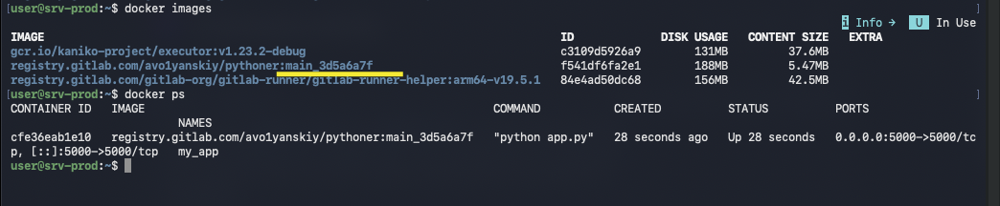
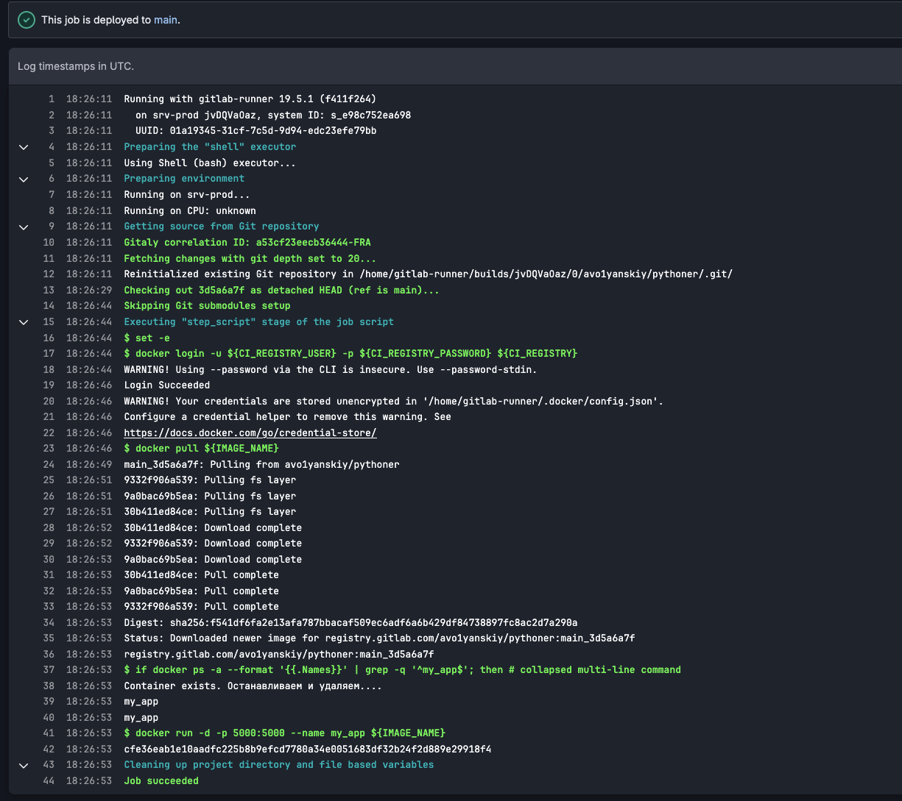
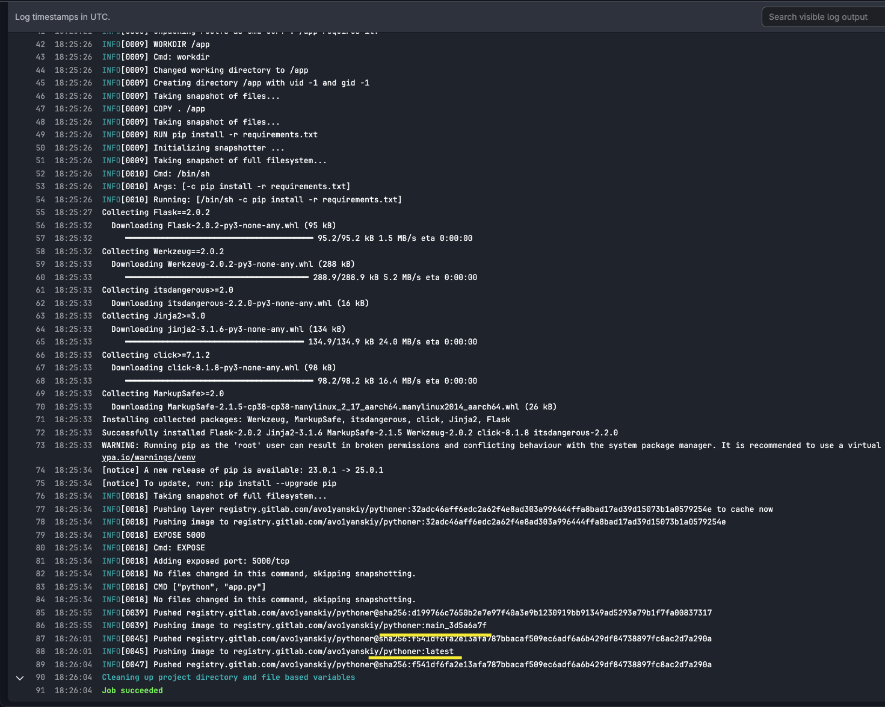
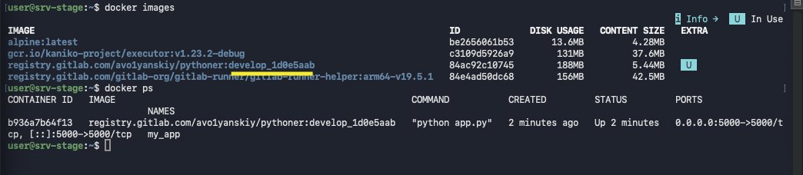
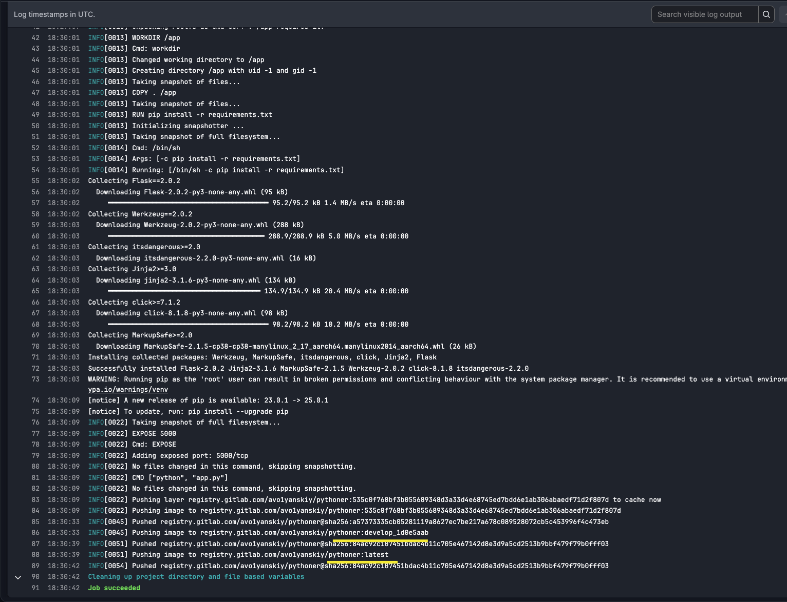
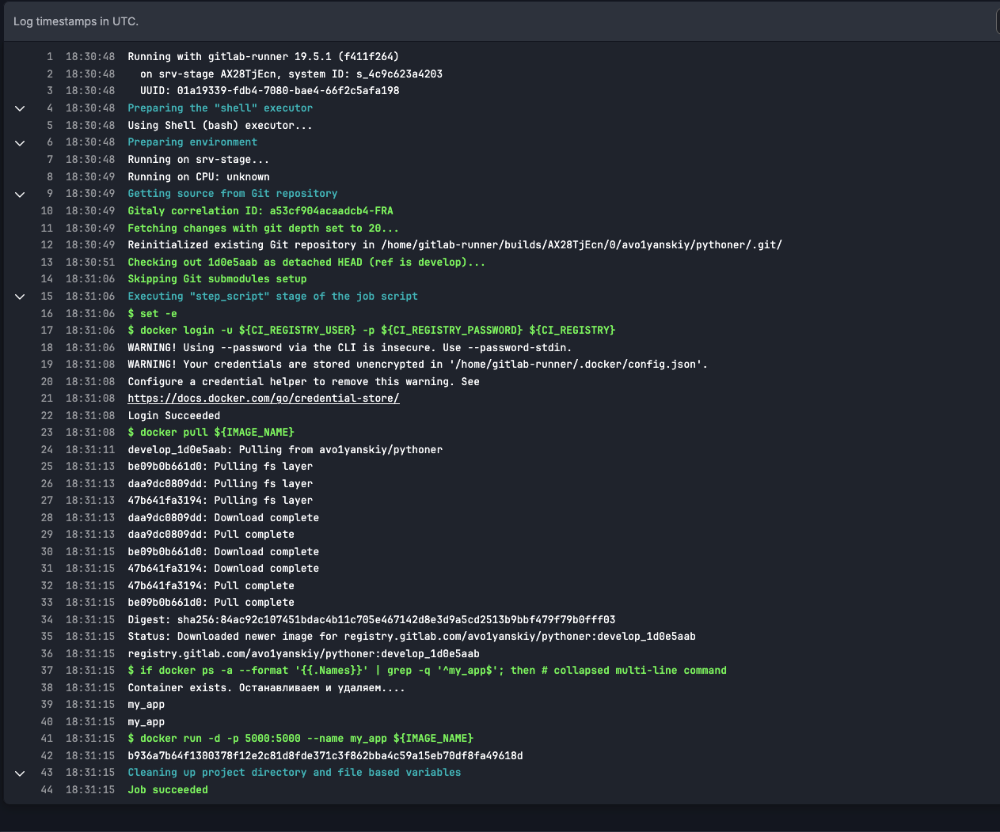
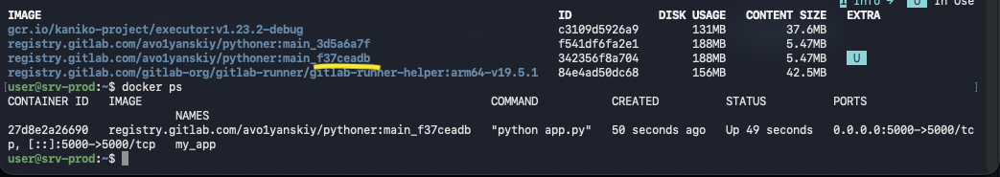
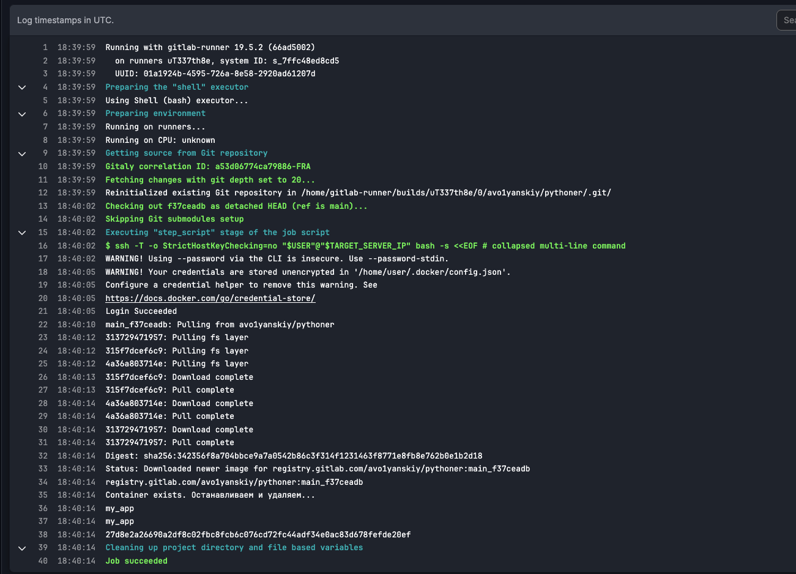
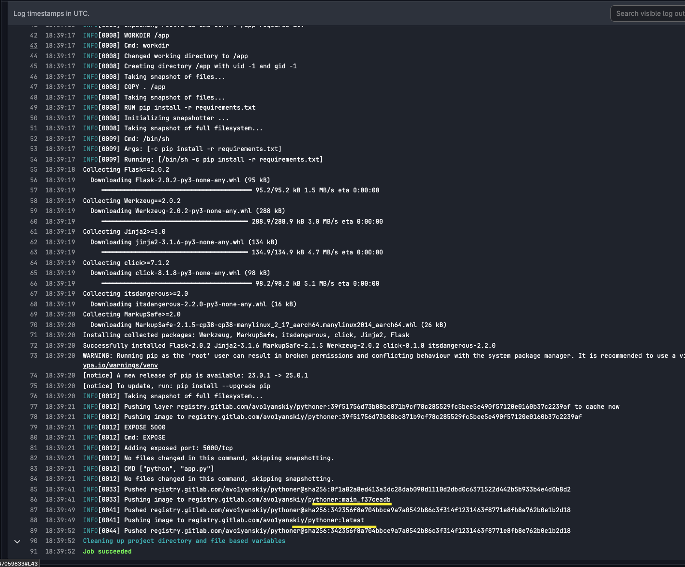

## Доп по первой задачи: 

После доработки  по первому абзацу получилось вот такое: 

```
stages:
  - build
  - deploy

variables:
  RUNNER_TAG: "ls-common"
  IMAGE_NAME: "registry.gitlab.com/avo1yanskiy/$CI_PROJECT_NAME:${CI_COMMIT_REF_NAME}_${CI_COMMIT_SHORT_SHA}"
workflow:
  rules:
    - if: '$CI_COMMIT_REF_NAME == "main"'
      variables:
        RUNNER_TAG: "lf-runner-docker1"
        RUNNER_TAG_SHELL: "lf-runner-shell1"
        IMAGE_TAG_PREFIX: "main"
    
    - if: '$CI_COMMIT_REF_NAME == "develop"'
      variables:
        RUNNER_TAG: "lf-runner-docker"
        RUNNER_TAG_SHELL: "lf-runner-shell2"
        IMAGE_TAG_PREFIX: "develop"

build_images:
  stage: build
  image:
    name: gcr.io/kaniko-project/executor:v1.23.2-debug
    entrypoint: [""]
  tags:
    - $RUNNER_TAG
  script:
    - mkdir -p /kaniko/.docker
    - echo "{\"auths\":{\"$CI_REGISTRY\":{\"username\":\"$CI_REGISTRY_USER\",\"password\":\"$CI_REGISTRY_PASSWORD\"}}}" > /kaniko/.docker/config.json
    - /kaniko/executor 
      --cache 
      --cache-repo $CI_REGISTRY_IMAGE 
      --context $CI_PROJECT_DIR 
      --dockerfile $CI_PROJECT_DIR/Dockerfile
      --destination "registry.gitlab.com/avo1yanskiy/$CI_PROJECT_NAME:${IMAGE_TAG_PREFIX}_$CI_COMMIT_SHORT_SHA"
      $(if [ "$CI_COMMIT_REF_NAME" = "main" ]; then echo "--destination registry.gitlab.com/avo1yanskiy/$CI_PROJECT_NAME:latest"; fi)
      $(if [ "$CI_COMMIT_REF_NAME" = "develop" ]; then echo "--destination registry.gitlab.com/avo1yanskiy/$CI_PROJECT_NAME:latest"; fi)


deploy:
  stage: deploy
  before_script:
    - set -e
    - docker login -u ${CI_REGISTRY_USER} -p ${CI_REGISTRY_PASSWORD} ${CI_REGISTRY}
  script:
    - docker pull ${IMAGE_NAME}
    - |
      if docker ps -a --format '{{.Names}}' | grep -q '^my_app$'; then
        echo "Container exists. Останавливаем и удаляем...."
        docker stop my_app && docker rm my_app
      fi
    - docker run -d -p 5000:5000 --name my_app ${IMAGE_NAME}
  tags:
    - $RUNNER_TAG_SHELL
  environment:
    name: $CI_COMMIT_REF_NAME
  only:
    - main
    - develop
```

main








develop








а это поправленый конфиг на бест практис задание:

```
stages:
  - build
  - deploy

variables:
  RUNNER_TAG_SHELL: "runners_shell"
  RUNNER_TAG: "ls-common"
  IMAGE_NAME: "registry.gitlab.com/avo1yanskiy/$CI_PROJECT_NAME:${CI_COMMIT_REF_NAME}_${CI_COMMIT_SHORT_SHA}"
  USER: user
workflow:
  rules:
    - if: '$CI_COMMIT_REF_NAME == "main"'
      variables:
        RUNNER_TAG: "runner_docker"
        IMAGE_TAG_PREFIX: "main"
        TARGET_SERVER_IP: "192.168.5.138"
    
    - if: '$CI_COMMIT_REF_NAME == "develop"'
      variables:
        RUNNER_TAG: "runner_docker"
        IMAGE_TAG_PREFIX: "develop"
        TARGET_SERVER_IP: "192.168.5.139"

build_images:
  stage: build
  image:
    name: gcr.io/kaniko-project/executor:v1.23.2-debug
    entrypoint: [""]
  tags:
    - $RUNNER_TAG
  script:
    - mkdir -p /kaniko/.docker
    - echo "{\"auths\":{\"$CI_REGISTRY\":{\"username\":\"$CI_REGISTRY_USER\",\"password\":\"$CI_REGISTRY_PASSWORD\"}}}" > /kaniko/.docker/config.json
    - /kaniko/executor 
      --cache 
      --cache-repo $CI_REGISTRY_IMAGE 
      --context $CI_PROJECT_DIR 
      --dockerfile $CI_PROJECT_DIR/Dockerfile
      --destination "registry.gitlab.com/avo1yanskiy/$CI_PROJECT_NAME:${IMAGE_TAG_PREFIX}_$CI_COMMIT_SHORT_SHA"
      $(if [ "$CI_COMMIT_REF_NAME" = "main" ]; then echo "--destination registry.gitlab.com/avo1yanskiy/$CI_PROJECT_NAME:latest"; fi)
      $(if [ "$CI_COMMIT_REF_NAME" = "develop" ]; then echo "--destination registry.gitlab.com/avo1yanskiy/$CI_PROJECT_NAME:latest"; fi)


deploy:
  stage: deploy
  script:
    - |
      ssh -T -o StrictHostKeyChecking=no "$USER"@"$TARGET_SERVER_IP" bash -s <<EOF
      set -e
      
      docker login -u '$CI_REGISTRY_USER' -p '$CI_REGISTRY_PASSWORD' '$CI_REGISTRY'
      
      docker pull '$IMAGE_NAME'

      if docker ps -a --format '{{.Names}}' | grep -q '^my_app$'; then
          echo 'Container exists. Останавливаем и удаляем...'
          docker stop my_app && docker rm my_app
      else
          echo 'Контейнер не найден'
      fi
      
      docker run -d -p 5000:5000 --name my_app '$IMAGE_NAME'
      EOF
  tags:
    - $RUNNER_TAG_SHELL
  environment:
    name: $CI_COMMIT_REF_NAME
  only:
    - main
    - develop
```

main





