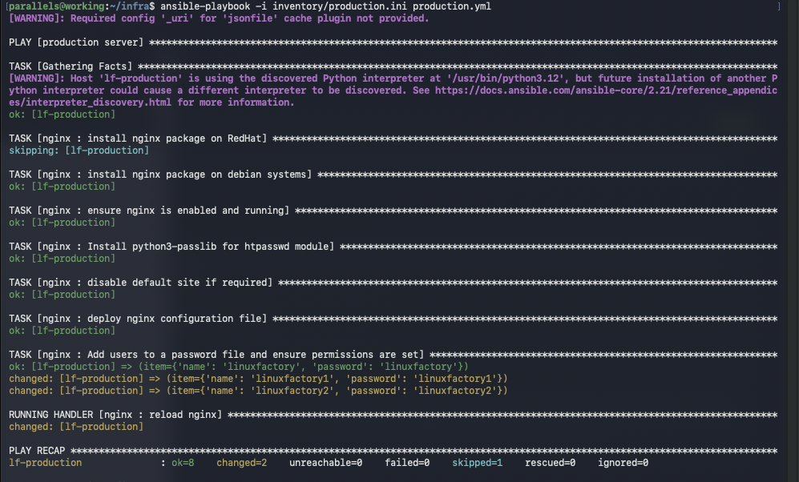
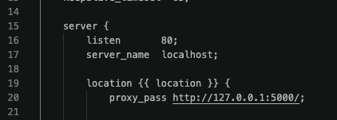
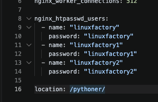
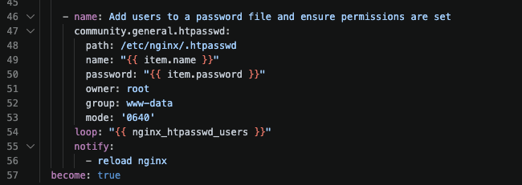
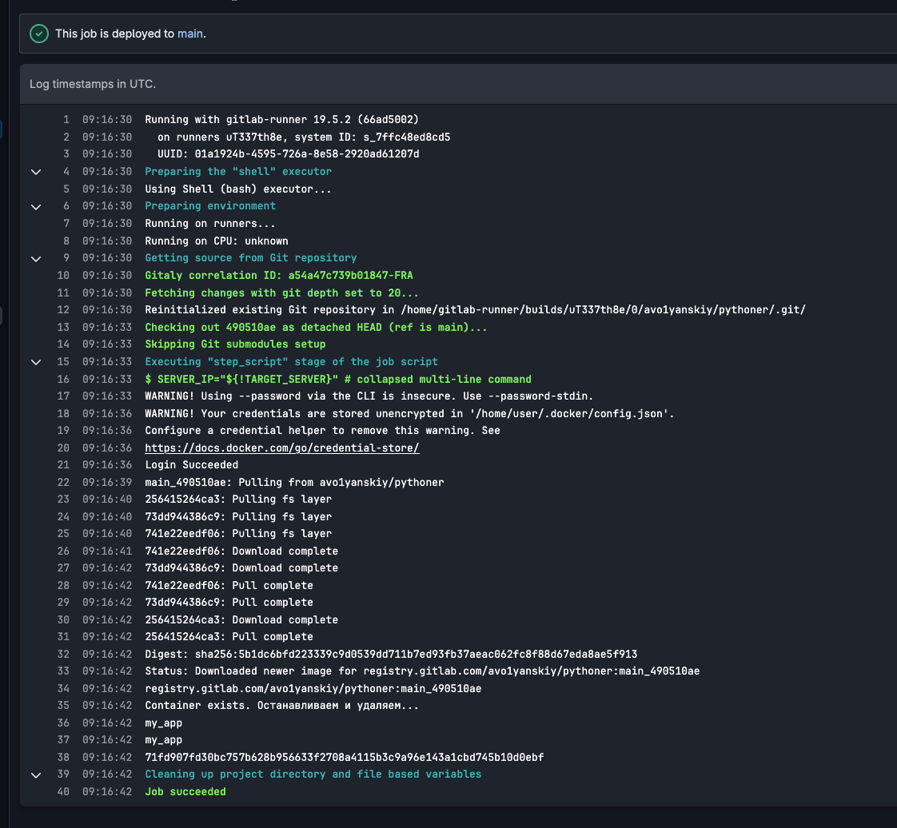
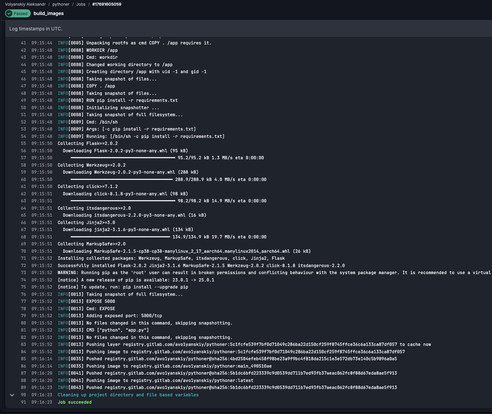

## Доп по первой задачи:

В nginx.conf.j2 путь /pythoner/ задан прямо в location, а по заданию он должен меняться через переменную для прода и стейджа. Вынеси путь в переменную и используй её в шаблоне, чтобы при смене адреса не править саму роль.





В показанной задаче community.general.htpasswd используется одна пара user и password, списка пользователей и loop нет. Сделай список с логинами и паролями и проход по нему, а то второго пользователя сейчас можно добавить только отдельной задачей или отдельным запуском с другими переменными.





В workflow запрещён только push, а завершающий when: always разрешает остальные источники запуска, в том числе расписание. Для ручного запуска через кнопку разреши CI_PIPELINE_SOURCE со значением web, остальные источники закрой, чтобы пайплайн не выкатывал приложение автоматически.
Переменная BRANCH нигде не используется. Если сверху выбрана main, а в BRANCH поставить DEVELOP, всё равно соберётся main. Этот лишний список лучше убирай, штатного выбора ветки сверху хватит.

```
stages:
  - build
  - deploy

variables:

  TARGET_SERVER:
    value: "TARGET_SERVER_MAIN"
    options:
      - "TARGET_SERVER_MAIN"
      - "TARGET_SERVER_DEVELOP"
    description: "Target server for deployment"

  RUNNER_TAG_SHELL: "runners_shell"
  IMAGE_NAME: "registry.gitlab.com/avo1yanskiy/$CI_PROJECT_NAME:${CI_COMMIT_REF_NAME}_${CI_COMMIT_SHORT_SHA}"
  USER: user
  RUNNER_TAG: "runner_docker"
  TARGET_SERVER_MAIN: "192.168.5.138"
  TARGET_SERVER_DEVELOP: "192.168.5.139"


workflow:
  rules:
    - if: $CI_PIPELINE_SOURCE == "push"
      when: never
    - if: '$CI_PIPELINE_SOURCE == "web" && ($CI_COMMIT_REF_NAME == "main" || $CI_COMMIT_REF_NAME == "develop")'
      when: always
    - when: never

build_images:
  stage: build
  image:
    name: gcr.io/kaniko-project/executor:v1.23.2-debug
    entrypoint: [""]
  tags:
    - $RUNNER_TAG
  script:
    - mkdir -p /kaniko/.docker
    - echo "{\"auths\":{\"$CI_REGISTRY\":{\"username\":\"$CI_REGISTRY_USER\",\"password\":\"$CI_REGISTRY_PASSWORD\"}}}" > /kaniko/.docker/config.json
    - |
      DESTINATIONS="--destination registry.gitlab.com/avo1yanskiy/$CI_PROJECT_NAME:${CI_COMMIT_REF_NAME}_${CI_COMMIT_SHORT_SHA}"
      if [ "$CI_COMMIT_REF_NAME" = "main" ]; then
        DESTINATIONS="$DESTINATIONS --destination registry.gitlab.com/avo1yanskiy/$CI_PROJECT_NAME:latest"
      elif [ "$CI_COMMIT_REF_NAME" = "develop" ]; then
        DESTINATIONS="$DESTINATIONS --destination registry.gitlab.com/avo1yanskiy/$CI_PROJECT_NAME:develop-latest"
      fi
      /kaniko/executor \
        --cache \
        --cache-repo "$CI_REGISTRY_IMAGE" \
        --context "$CI_PROJECT_DIR" \
        --dockerfile "$CI_PROJECT_DIR/Dockerfile" \
        $DESTINATIONS

deploy:
  stage: deploy
  script:
    - |
      SERVER_IP="${!TARGET_SERVER}"

      ssh -T -o StrictHostKeyChecking=no "$USER"@"$SERVER_IP" bash -s <<EOF
      set -e
      
      docker login -u '$CI_REGISTRY_USER' -p '$CI_REGISTRY_PASSWORD' '$CI_REGISTRY'
      
      docker pull '$IMAGE_NAME'

      if docker ps -a --format '{{.Names}}' | grep -q '^my_app$'; then
          echo 'Container exists. Останавливаем и удаляем...'
          docker stop my_app && docker rm my_app
      else
          echo 'Контейнер не найден'
      fi
      
      docker run -d -p 5000:5000 --name my_app '$IMAGE_NAME'
      EOF
  tags:
    - $RUNNER_TAG_SHELL
  environment:
    name: $CI_COMMIT_REF_NAME
  only:
    - main
    - develop
```



