## Домашнее задание

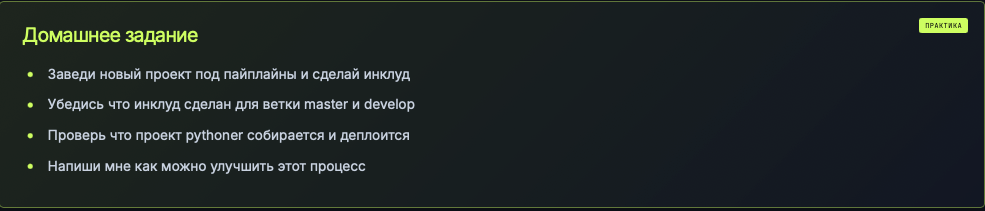


Собрал при помощи include: 


```
include:
  - project: "avo1yanskiy/devops-pipelines"
    ref: main
    file: "pythoner/.gitlab-ci.yml"
```
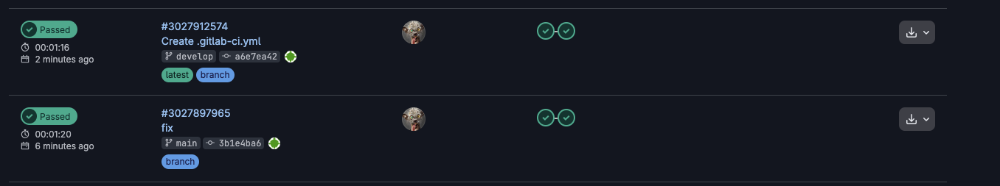

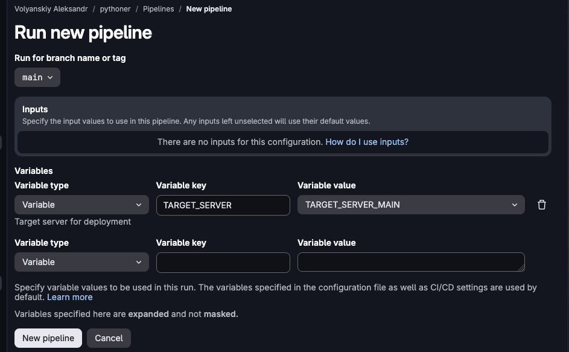

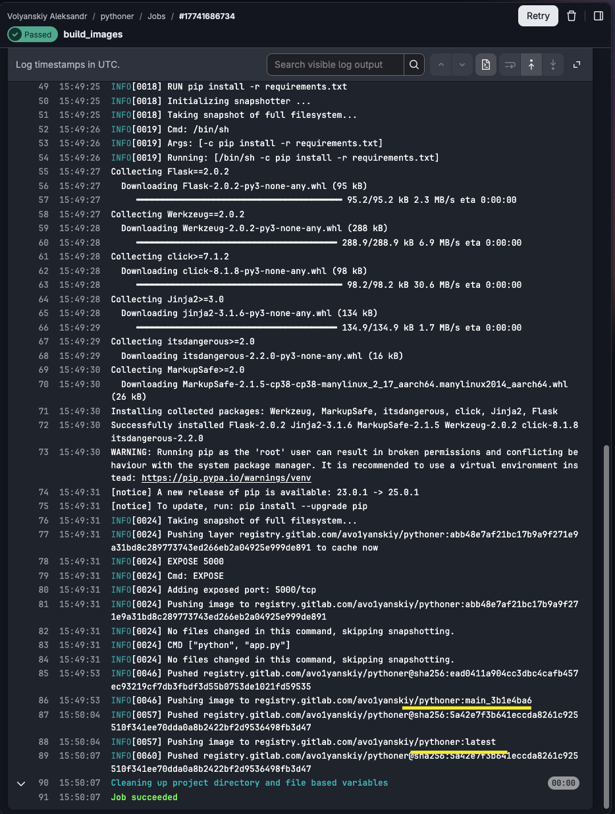

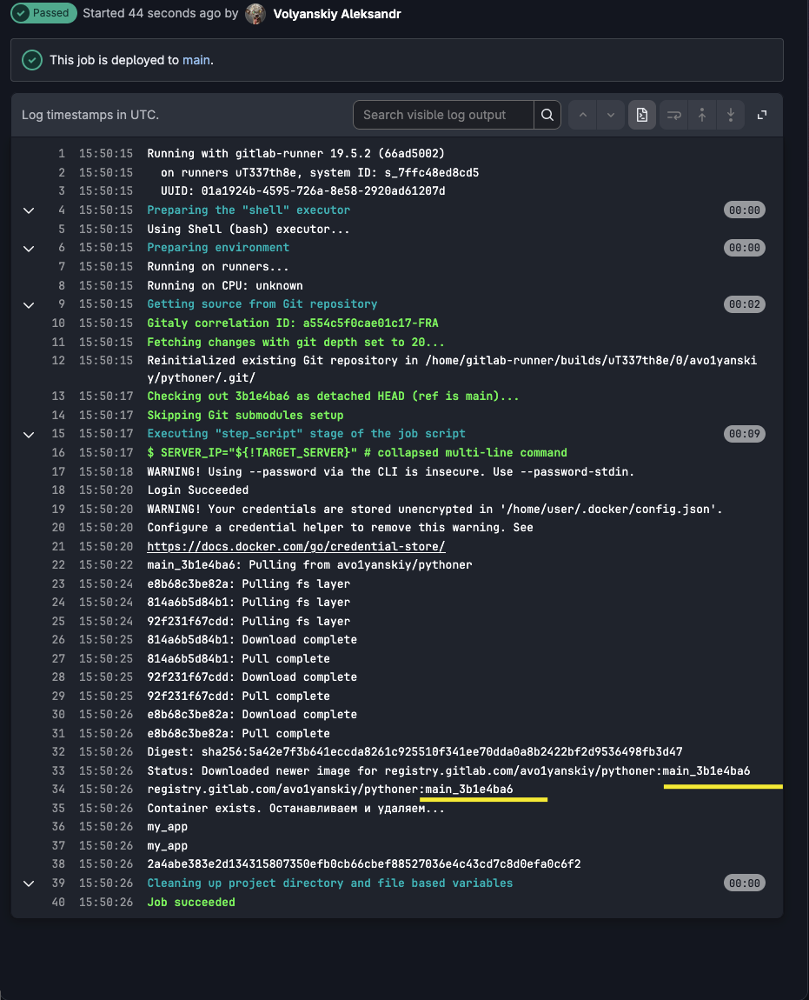

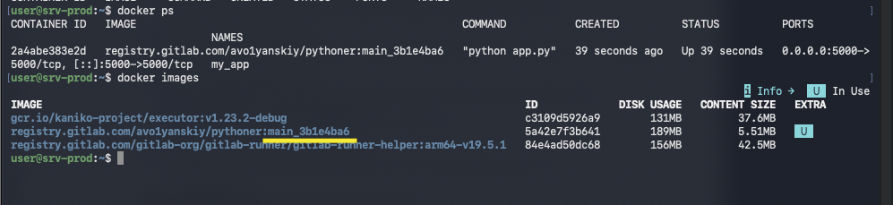

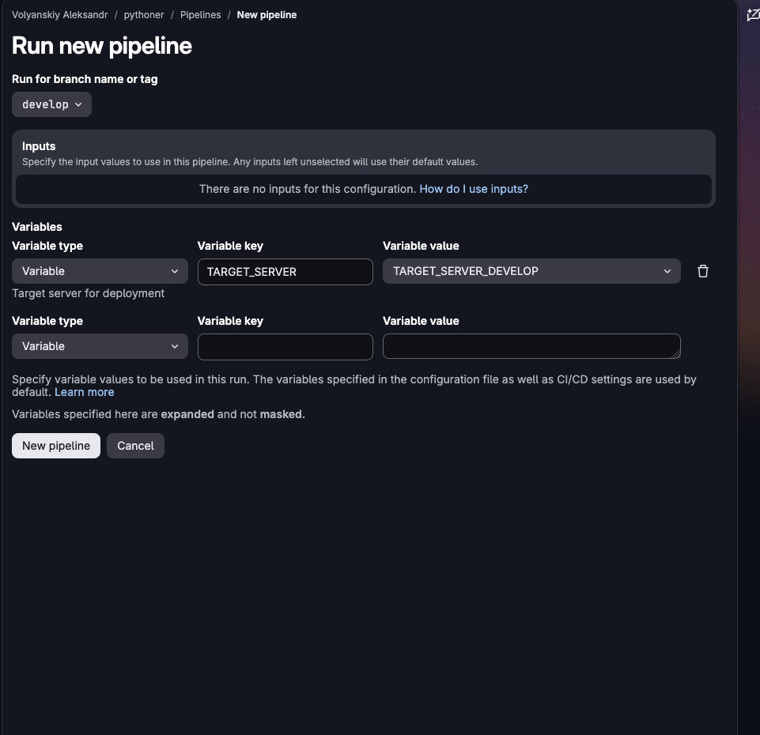

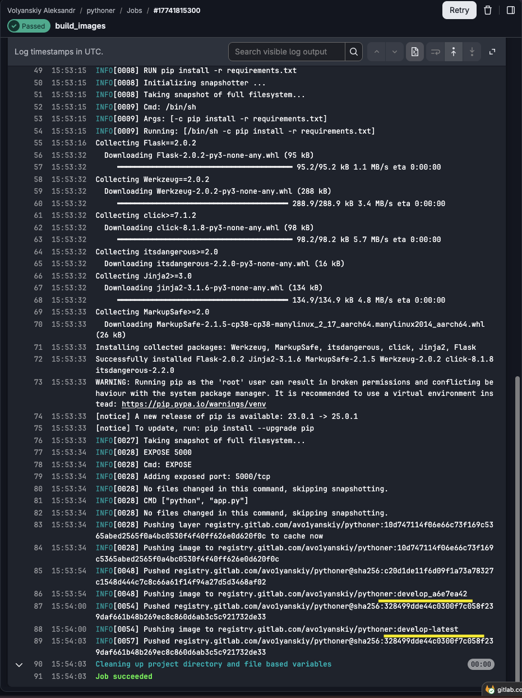

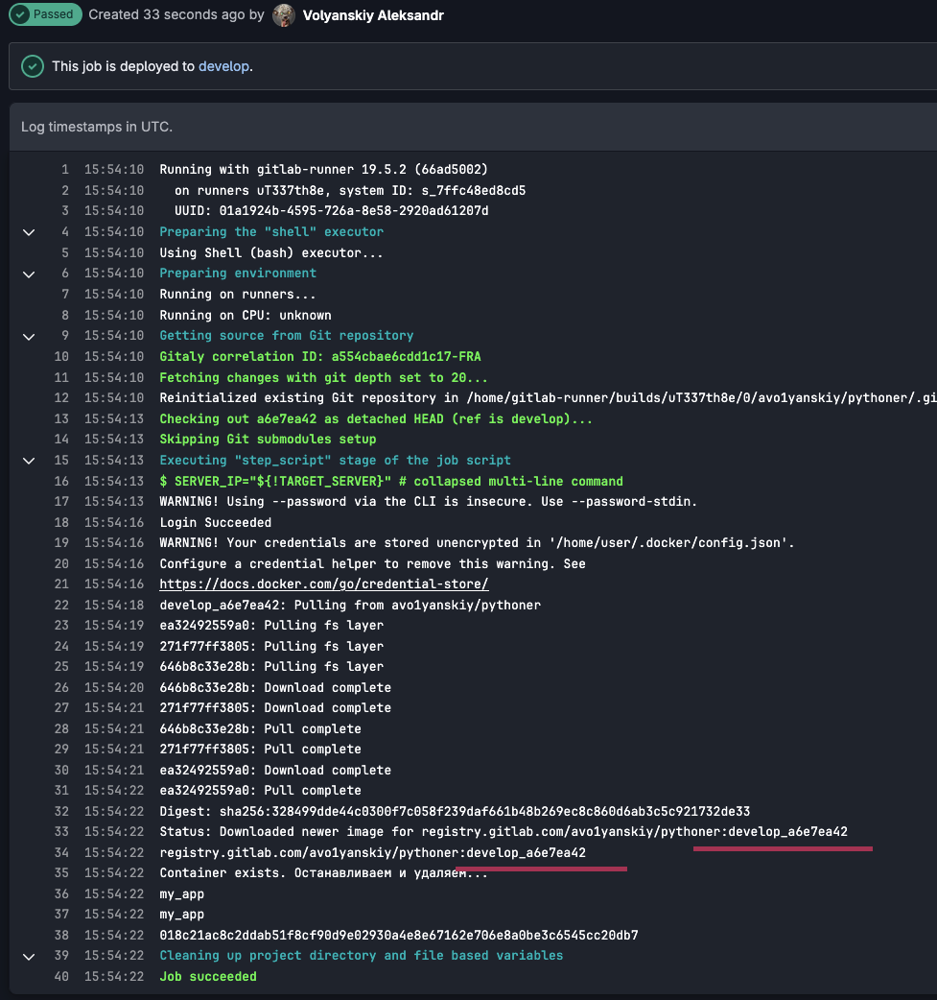


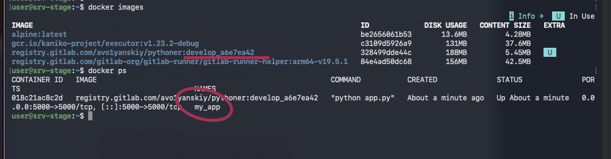


Собрал при помощи  настройки в самом gitlab:

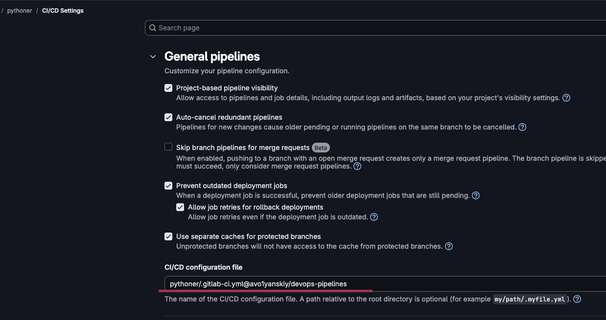

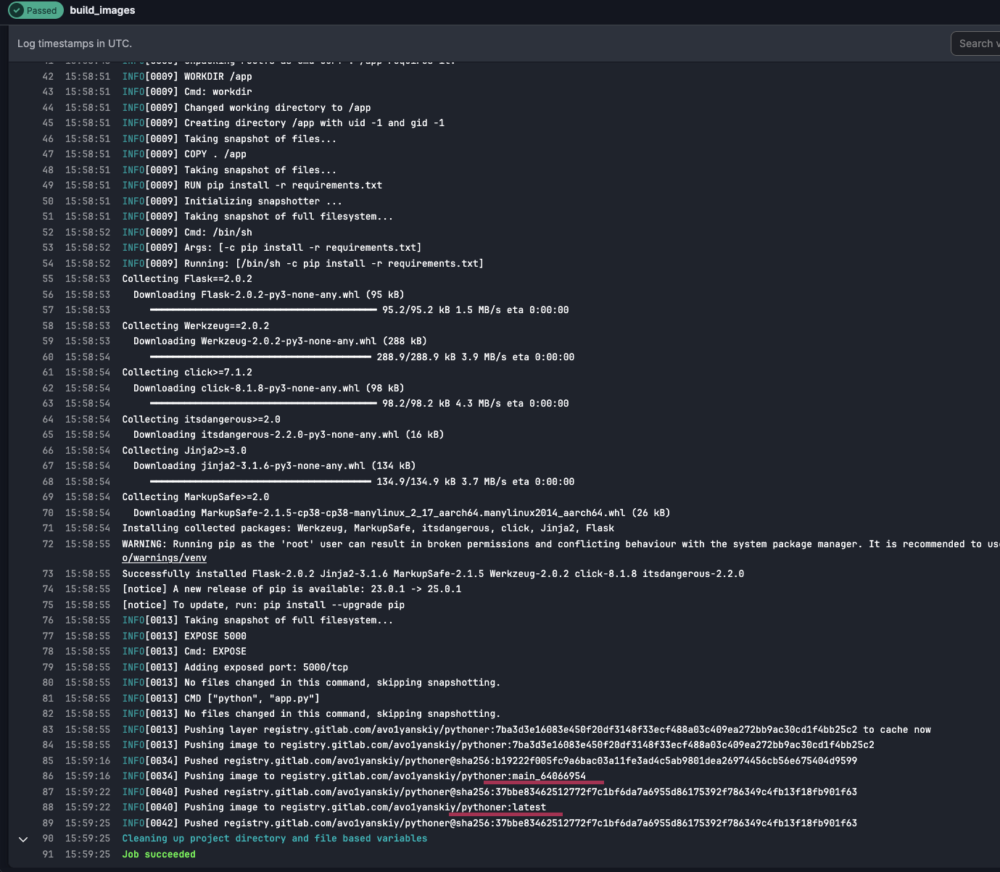

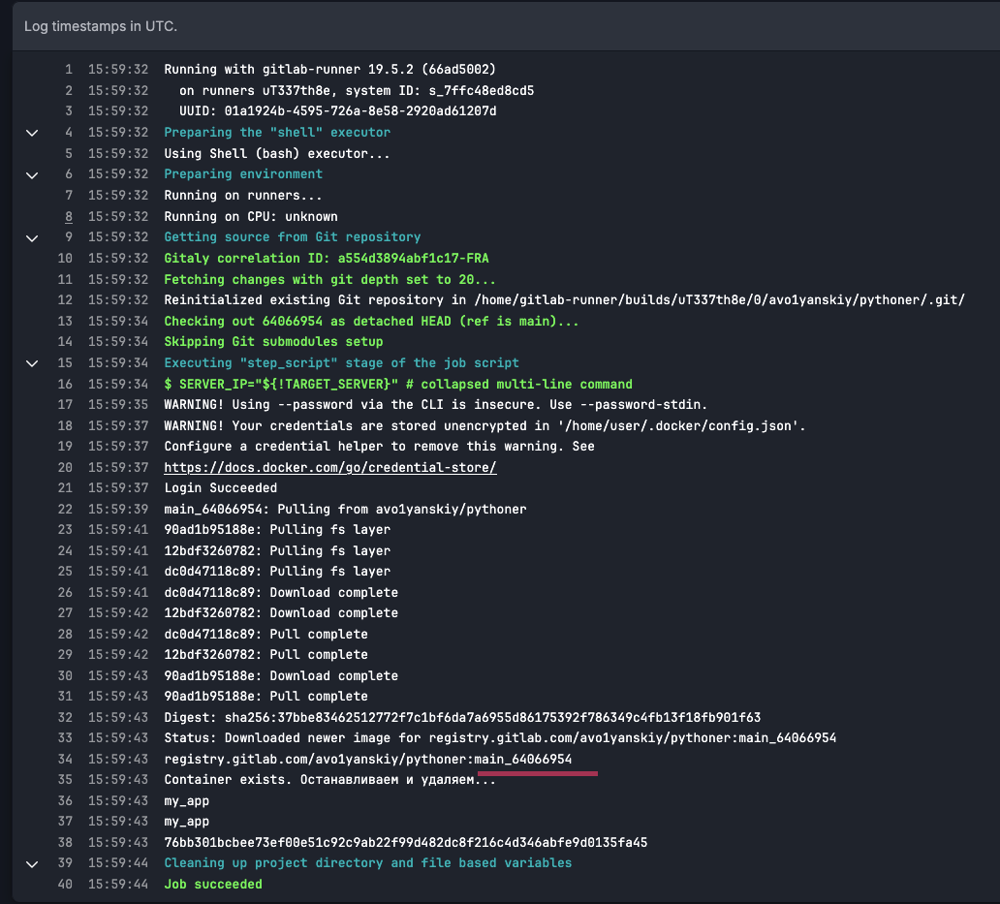

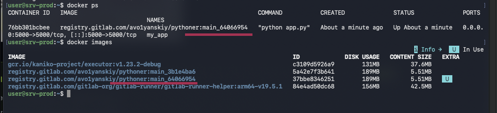
