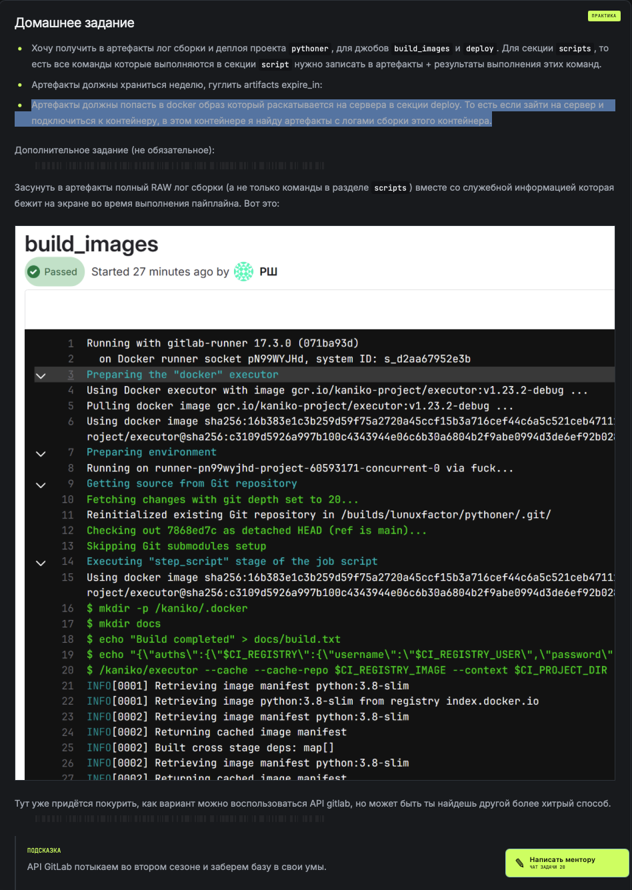
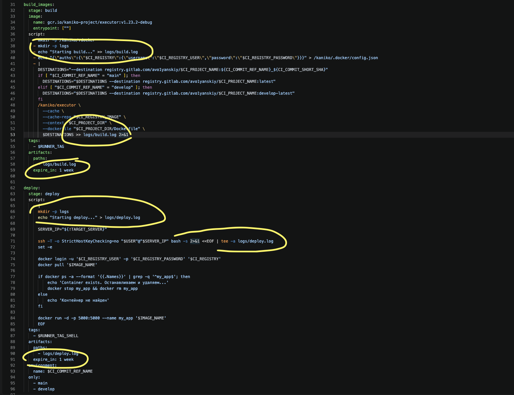
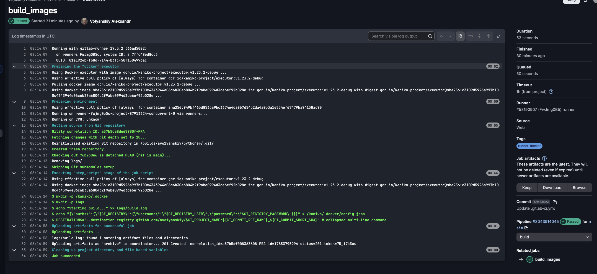
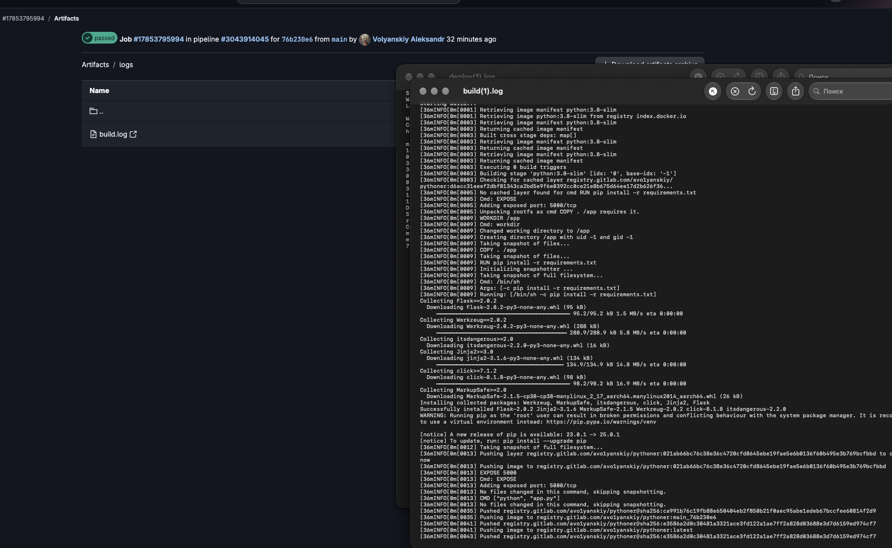
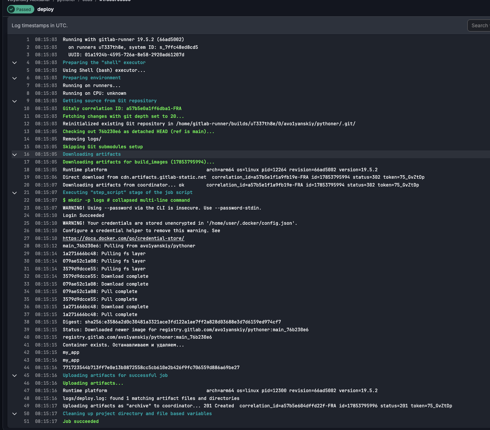
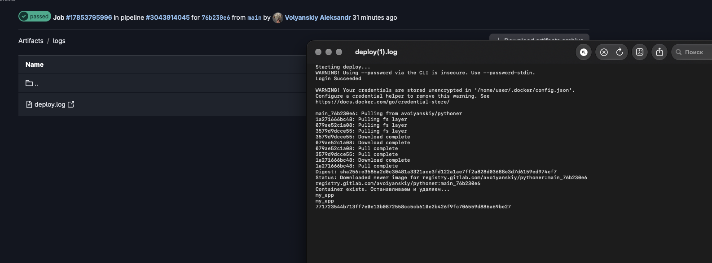
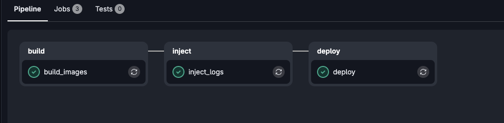
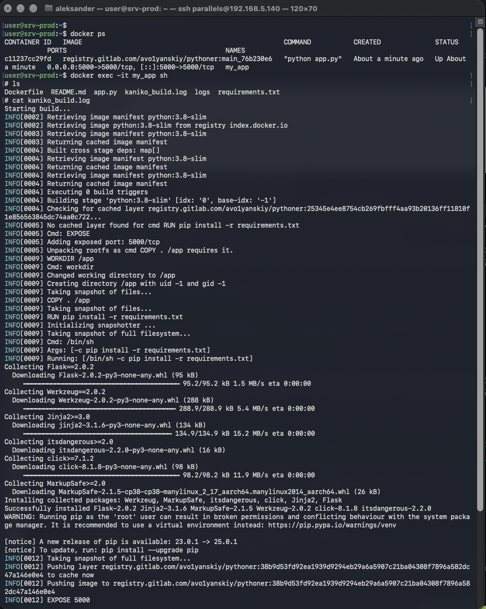

## Домашнее задание




=== Это первые два задания ===















=== Третье задание, весь лог сборки ===

```
stages:
  - build
  - inject
  - deploy

variables:

  TARGET_SERVER:
    value: "TARGET_SERVER_MAIN"
    options:
      - "TARGET_SERVER_MAIN"
      - "TARGET_SERVER_DEVELOP"
    description: "Target server for deployment"

  RUNNER_TAG_SHELL: "runners_shell"
  IMAGE_NAME: "registry.gitlab.com/avo1yanskiy/$CI_PROJECT_NAME:${CI_COMMIT_REF_NAME}_${CI_COMMIT_SHORT_SHA}"
  USER: user
  RUNNER_TAG: "runner_docker"
  TARGET_SERVER_MAIN: "192.168.5.138"
  TARGET_SERVER_DEVELOP: "192.168.5.139"


workflow:
  rules:
    - if: $CI_PIPELINE_SOURCE == "push"
      when: never
    - if: '$CI_PIPELINE_SOURCE == "web" && ($CI_COMMIT_REF_NAME == "main" || $CI_COMMIT_REF_NAME == "develop")'
      when: always
    - when: never

build_images:
  stage: build
  image:
    name: gcr.io/kaniko-project/executor:v1.23.2-debug
    entrypoint: [""]
  script:
    - mkdir -p /kaniko/.docker
    - mkdir -p logs
    - echo "Starting build..." >> logs/build.log
    - echo "{\"auths\":{\"$CI_REGISTRY\":{\"username\":\"$CI_REGISTRY_USER\",\"password\":\"$CI_REGISTRY_PASSWORD\"}}}" > /kaniko/.docker/config.json
    - |
      DESTINATIONS="--destination registry.gitlab.com/avo1yanskiy/$CI_PROJECT_NAME:${CI_COMMIT_REF_NAME}_${CI_COMMIT_SHORT_SHA}"
      if [ "$CI_COMMIT_REF_NAME" = "main" ]; then
        DESTINATIONS="$DESTINATIONS --destination registry.gitlab.com/avo1yanskiy/$CI_PROJECT_NAME:latest"
      elif [ "$CI_COMMIT_REF_NAME" = "develop" ]; then
        DESTINATIONS="$DESTINATIONS --destination registry.gitlab.com/avo1yanskiy/$CI_PROJECT_NAME:develop-latest"
      fi
      /kaniko/executor \
        --cache \
        --cache-repo "$CI_REGISTRY_IMAGE" \
        --context "$CI_PROJECT_DIR" \
        --dockerfile "$CI_PROJECT_DIR/Dockerfile" \
        $DESTINATIONS >> logs/build.log 2>&1
  tags:
    - $RUNNER_TAG
  artifacts:
    paths:
      - logs/build.log
    expire_in: 1 week


inject_logs:
  stage: inject
  image:
    name: gcr.io/kaniko-project/executor:v1.23.2-debug
    entrypoint: [""]
  script:
    - mkdir -p /kaniko/.docker
    - echo "{\"auths\":{\"$CI_REGISTRY\":{\"username\":\"$CI_REGISTRY_USER\",\"password\":\"$CI_REGISTRY_PASSWORD\"}}}" > /kaniko/.docker/config.json

    - |
      cat <<EOF > Dockerfile.log
      FROM $CI_REGISTRY_IMAGE:${CI_COMMIT_REF_NAME}_${CI_COMMIT_SHORT_SHA}
      COPY logs/build.log /app/kaniko_build.log
      EOF

    # 2. Запускаем Kaniko поверх уже готового образа
    # Отключаем кэш, чтобы слой с логом гарантированно перезаписался
    - |
      DESTINATIONS="--destination $CI_REGISTRY_IMAGE:${CI_COMMIT_REF_NAME}_${CI_COMMIT_SHORT_SHA}"
      if [ "$CI_COMMIT_REF_NAME" = "main" ]; then
        DESTINATIONS="$DESTINATIONS --destination $CI_REGISTRY_IMAGE:latest"
      elif [ "$CI_COMMIT_REF_NAME" = "develop" ]; then
        DESTINATIONS="$DESTINATIONS --destination $CI_REGISTRY_IMAGE:develop-latest"
      fi

      /kaniko/executor \
        --cache=false \
        --context "$CI_PROJECT_DIR" \
        --dockerfile "$CI_PROJECT_DIR/Dockerfile.log" \
        $DESTINATIONS
  tags:
    - $RUNNER_TAG


deploy:
  stage: deploy
  script:
    - |
      SERVER_IP="${!TARGET_SERVER}"

      ssh -T -o StrictHostKeyChecking=no "$USER"@"$SERVER_IP" bash -s <<EOF
      set -e
      
      docker login -u ${CI_REGISTRY_USER} -p ${CI_REGISTRY_PASSWORD} ${CI_REGISTRY}
      
      docker pull ${IMAGE_NAME}

      if docker ps -a --format '{{.Names}}' | grep -q '^my_app$'; then
          echo 'Container exists. Останавливаем и удаляем...'
          docker stop my_app && docker rm my_app
      else
          echo 'Контейнер не найден'
      fi
      
      docker run -d -p 5000:5000 --name my_app ${IMAGE_NAME}
      EOF
  tags:
    - $RUNNER_TAG_SHELL
  environment:
    name: $CI_COMMIT_REF_NAME
  only:
    - main
    - develop
```




