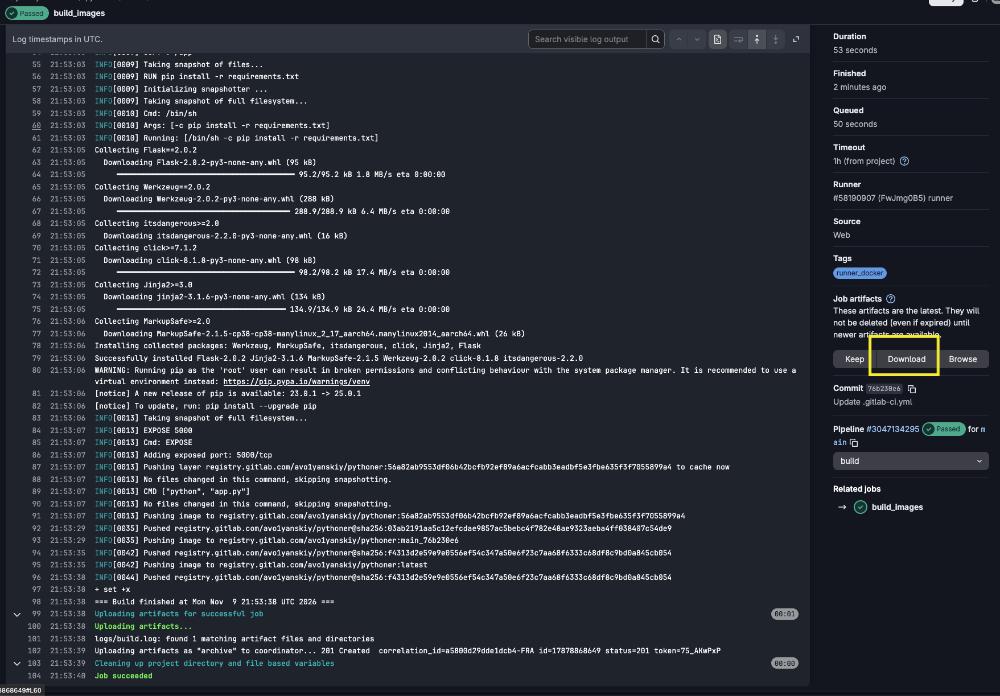
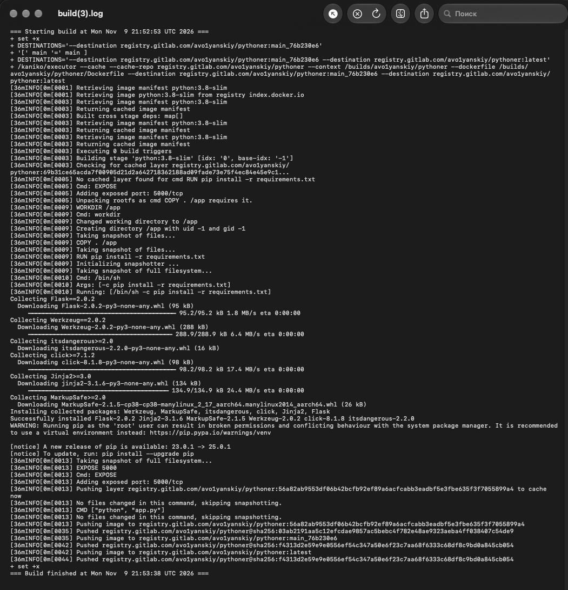
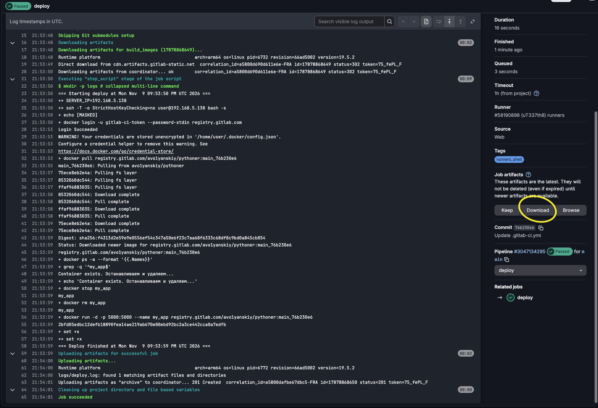
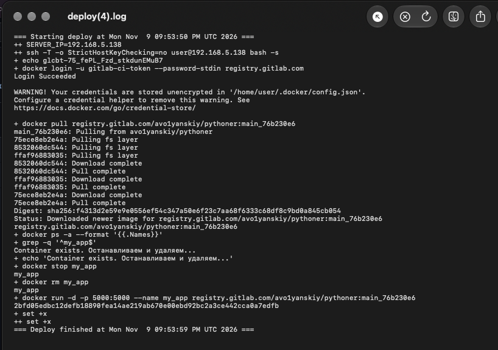

## Домашнее задание










```

stages:
  - build
  - deploy

variables:

  TARGET_SERVER:
    value: "TARGET_SERVER_MAIN"
    options:
      - "TARGET_SERVER_MAIN"
      - "TARGET_SERVER_DEVELOP"
    description: "Target server for deployment"

  RUNNER_TAG_SHELL: "runners_shell"
  IMAGE_NAME: "registry.gitlab.com/avo1yanskiy/$CI_PROJECT_NAME:${CI_COMMIT_REF_NAME}_${CI_COMMIT_SHORT_SHA}"
  USER: user
  RUNNER_TAG: "runner_docker"
  TARGET_SERVER_MAIN: "192.168.5.138"
  TARGET_SERVER_DEVELOP: "192.168.5.139"


workflow:
  rules:
    - if: $CI_PIPELINE_SOURCE == "push"
      when: never
    - if: '$CI_PIPELINE_SOURCE == "web" && ($CI_COMMIT_REF_NAME == "main" || $CI_COMMIT_REF_NAME == "develop")'
      when: always
    - when: never

build_images:
  stage: build
  image:
    name: gcr.io/kaniko-project/executor:v1.23.2-debug
    entrypoint: [""]
  script:
    - mkdir -p /kaniko/.docker
    - mkdir -p logs
    - |
      {
        echo "=== Starting build at $(date) ==="
        
        set -x
        
        set +x
        echo "{\"auths\":{\"$CI_REGISTRY\":{\"username\":\"$CI_REGISTRY_USER\",\"password\":\"$CI_REGISTRY_PASSWORD\"}}}" > /kaniko/.docker/config.json
        set -x
        
        # Формируем теги
        DESTINATIONS="--destination registry.gitlab.com/avo1yanskiy/$CI_PROJECT_NAME:${CI_COMMIT_REF_NAME}_${CI_COMMIT_SHORT_SHA}"
        if [ "$CI_COMMIT_REF_NAME" = "main" ]; then
          DESTINATIONS="$DESTINATIONS --destination registry.gitlab.com/avo1yanskiy/$CI_PROJECT_NAME:latest"
        elif [ "$CI_COMMIT_REF_NAME" = "develop" ]; then
          DESTINATIONS="$DESTINATIONS --destination registry.gitlab.com/avo1yanskiy/$CI_PROJECT_NAME:develop-latest"
        fi
        
        /kaniko/executor \
          --cache \
          --cache-repo "$CI_REGISTRY_IMAGE" \
          --context "$CI_PROJECT_DIR" \
          --dockerfile "$CI_PROJECT_DIR/Dockerfile" \
          $DESTINATIONS
          
        set +x
        echo "=== Build finished at $(date) ==="
      } 2>&1 | tee -a logs/build.log
  tags:
    - $RUNNER_TAG
  artifacts:
    paths:
      - logs/build.log
    expire_in: 1 week

deploy:
  stage: deploy
  script:
    - |
      mkdir -p logs
      
      {
        echo "=== Starting deploy at $(date) ==="
        
        set -x
        
        SERVER_IP="${!TARGET_SERVER}"

        ssh -T -o StrictHostKeyChecking=no "$USER"@"$SERVER_IP" bash -s <<EOF
      set -e
      
      set -x
      
      echo "${CI_REGISTRY_PASSWORD}" | docker login -u "${CI_REGISTRY_USER}" --password-stdin "${CI_REGISTRY}"
      
      docker pull ${IMAGE_NAME}

      if docker ps -a --format '{{.Names}}' | grep -q '^my_app$'; then
          echo 'Container exists. Останавливаем и удаляем...'
          docker stop my_app && docker rm my_app
      else
          echo 'Контейнер не найден'
      fi
      
      docker run -d -p 5000:5000 --name my_app ${IMAGE_NAME}
      
      set +x
      EOF
        
        set +x
        echo "=== Deploy finished at $(date) ==="
      } 2>&1 | tee -a logs/deploy.log
  tags:
    - $RUNNER_TAG_SHELL
  artifacts:
    paths:
      - logs/deploy.log
    expire_in: 1 week
  environment:
    name: $CI_COMMIT_REF_NAME
  only:
    - main
    - develop
```
