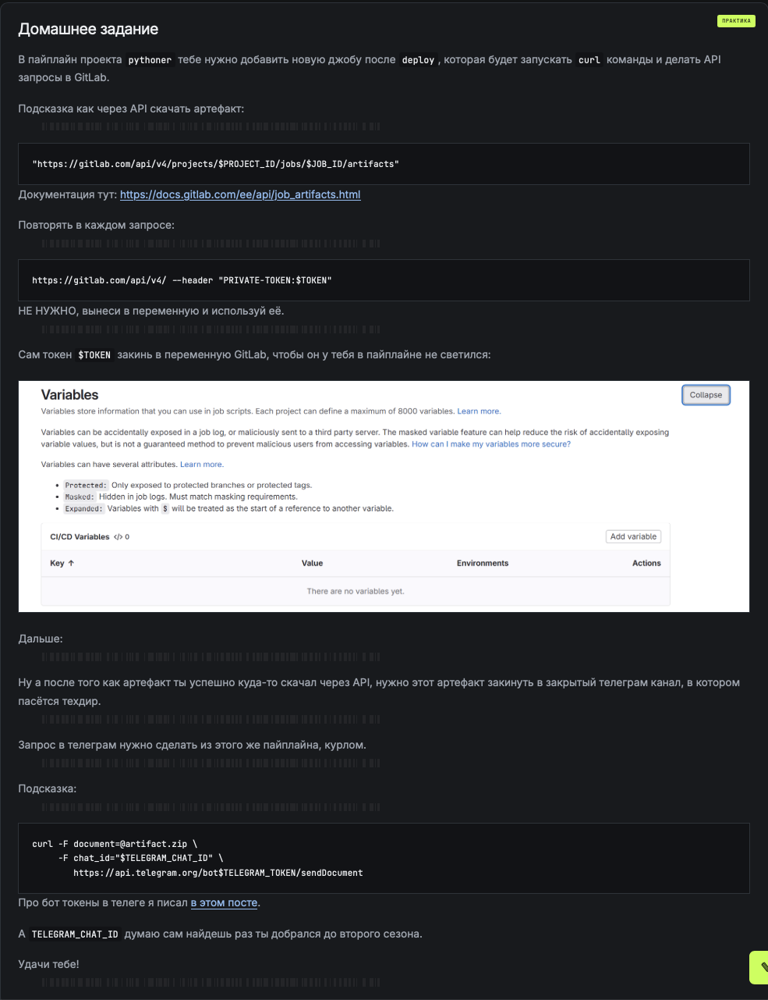
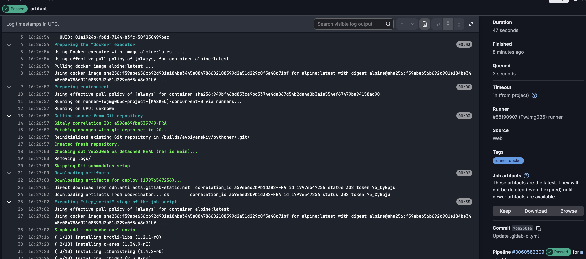
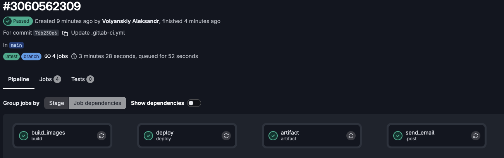
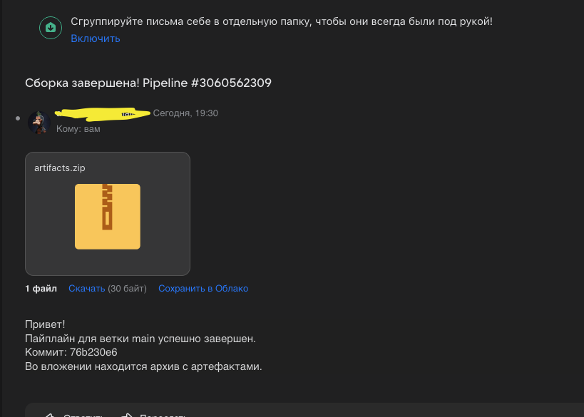

## Домашнее задание

Вот тут через курл скачал себе из deploy артефакты: 

В скрине видно что я их сохранил под artifacts.zip

Тут я через курл отправлял "техдиру" на почту артефакты :D. 

Сделал сам на себя чтобы голову себе пока не морочить с безопасностью гугла. Обычно все же такие вещи гоняют через внутренний сервер. отправку на сервере делал через ИИ слишком что то заморочено получилось)

