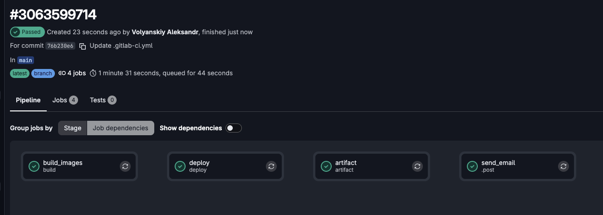
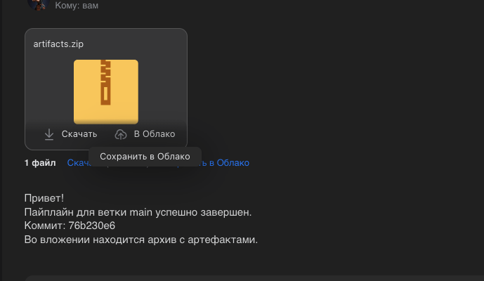

## Домашнее задание





```
stages:
  - build
  - deploy
  - artifact

variables:

  TARGET_SERVER:
    value: "TARGET_SERVER_MAIN"
    options:
      - "TARGET_SERVER_MAIN"
      - "TARGET_SERVER_DEVELOP"
    description: "Target server for deployment"

  RUNNER_TAG_SHELL: "runners_shell"
  IMAGE_NAME: "registry.gitlab.com/avo1yanskiy/$CI_PROJECT_NAME:${CI_COMMIT_REF_NAME}_${CI_COMMIT_SHORT_SHA}"
  USER: user
  RUNNER_TAG: "runner_docker"
  TARGET_SERVER_MAIN: "192.168.5.138"
  TARGET_SERVER_DEVELOP: "192.168.5.139"


workflow:
  rules:
    - if: $CI_PIPELINE_SOURCE == "push"
      when: never
    - if: '$CI_PIPELINE_SOURCE == "web" && ($CI_COMMIT_REF_NAME == "main" || $CI_COMMIT_REF_NAME == "develop")'
      when: always
    - when: never

build_images:
  stage: build
  image:
    name: gcr.io/kaniko-project/executor:v1.23.2-debug
    entrypoint: [""]
  script:
    - mkdir -p /kaniko/.docker
    - mkdir -p logs
    - |
      {
        echo "=== Starting build at $(date) ==="

        set -x

        set +x
        echo "{\"auths\":{\"$CI_REGISTRY\":{\"username\":\"$CI_REGISTRY_USER\",\"password\":\"$CI_REGISTRY_PASSWORD\"}}}" > /kaniko/.docker/config.json
        set -x

        # Формируем теги
        DESTINATIONS="--destination registry.gitlab.com/avo1yanskiy/$CI_PROJECT_NAME:${CI_COMMIT_REF_NAME}_${CI_COMMIT_SHORT_SHA}"
        if [ "$CI_COMMIT_REF_NAME" = "main" ]; then
          DESTINATIONS="$DESTINATIONS --destination registry.gitlab.com/avo1yanskiy/$CI_PROJECT_NAME:latest"
        elif [ "$CI_COMMIT_REF_NAME" = "develop" ]; then
          DESTINATIONS="$DESTINATIONS --destination registry.gitlab.com/avo1yanskiy/$CI_PROJECT_NAME:develop-latest"
        fi

        /kaniko/executor \
          --cache \
          --cache-repo "$CI_REGISTRY_IMAGE" \
          --context "$CI_PROJECT_DIR" \
          --dockerfile "$CI_PROJECT_DIR/Dockerfile" \
          $DESTINATIONS

        set +x
        echo "=== Build finished at $(date) ==="
      } 2>&1 | tee -a logs/build.log
  tags:
    - $RUNNER_TAG
  artifacts:
    paths:
      - logs/build.log
    expire_in: 1 week

deploy:
  stage: deploy
  script:
    - |
      mkdir -p logs

      {
        echo "=== Starting deploy at $(date) ==="

        set -x

        SERVER_IP="${!TARGET_SERVER}"

        ssh -T -o StrictHostKeyChecking=no "$USER"@"$SERVER_IP" bash -s <<EOF
      set -e

      set -x

      echo "${CI_REGISTRY_PASSWORD}" | docker login -u "${CI_REGISTRY_USER}" --password-stdin "${CI_REGISTRY}"

      docker pull ${IMAGE_NAME}

      if docker ps -a --format '{{.Names}}' | grep -q '^my_app$'; then
          echo 'Container exists. Останавливаем и удаляем...'
          docker stop my_app && docker rm my_app
      else
          echo 'Контейнер не найден'
      fi

      docker run -d -p 5000:5000 --name my_app ${IMAGE_NAME}

      set +x
      EOF

        set +x
        echo "=== Deploy finished at $(date) ==="
      } 2>&1 | tee -a logs/deploy.log
  tags:
    - $RUNNER_TAG_SHELL
  artifacts:
    paths:
      - logs/deploy.log
    reports:
      dotenv: deploy.env
    expire_in: 1 week
  after_script:
    - echo "DEPLOY_JOB_ID=$CI_JOB_ID" > deploy.env
  environment:
    name: $CI_COMMIT_REF_NAME
  only:
    - main
    - develop


#### ВОТ ЭТО БОЛЕЕ ЛОГИЧНЫЙ ПОДХОД ####
# artifact:
#   stage: artifact
#   image: alpine:latest
#   needs:
#     - job: deploy
#       artifacts: true
#   tags:
#     - $RUNNER_TAG
#   script:
#     - apk add --no-cache zip
#     - zip -r artifacts.zip logs/
#   artifacts:
#     paths:
#       - artifacts.zip
#     expire_in: 1 week
#### ВОТ ЭТО БОЛЕЕ ЛОГИЧНЫЙ ПОДХОД ####

artifact:
  stage: artifact
  image: alpine:latest
  needs:
    - job: deploy
      artifacts: true
  tags:
    - $RUNNER_TAG
  script:
    - apk add --no-cache curl unzip
    - |

      echo "Скачиваем артефакты для Job ID: $DEPLOY_JOB_ID"
      curl -fSL \
           --header "PRIVATE-TOKEN: $TOKEN" \
           -o artifacts.zip \
           "https://gitlab.com/api/v4/projects/$CI_PROJECT_ID/jobs/$DEPLOY_JOB_ID/artifacts"
  artifacts:
    paths:
      - artifacts.zip

send_email:
  stage: .post
  image: alpine:latest
  needs:
    - job: artifact
      artifacts: true
  tags:
    - $RUNNER_TAG
  script:
    # coreutils нужен для утилиты base64
    - apk add --no-cache curl coreutils
    - |
      # 1. Генерируем уникальный разделитель (boundary)
      BOUNDARY="----=_Part_$(date +%s)_$RANDOM"

      # 2. Создаем текстовую часть письма и заголовки
      {
        echo "From: $GMAIL_USER"
        echo "To: $MAIL_TO"
        echo "Subject: Сборка завершена! Pipeline #$CI_PIPELINE_ID"
        echo "MIME-Version: 1.0"
        echo "Content-Type: multipart/mixed; boundary=\"$BOUNDARY\""
        echo ""
        echo "--$BOUNDARY"
        echo "Content-Type: text/plain; charset=UTF-8"
        echo ""
        echo "Привет!"
        echo "Пайплайн для ветки $CI_COMMIT_REF_NAME успешно завершен."
        echo "Коммит: $CI_COMMIT_SHORT_SHA"
        echo "Во вложении находится архив с артефактами."
        echo ""
        echo "--$BOUNDARY"
        echo "Content-Type: application/zip; name=\"artifacts.zip\""
        echo "Content-Transfer-Encoding: base64"
        echo "Content-Disposition: attachment; filename=\"artifacts.zip\""
        echo ""
      } > mail.txt

      # 3. Кодируем ZIP в base64 и дописываем в конец письма
      base64 artifacts.zip >> mail.txt

      # 4. Закрываем MIME-разделитель
      echo "" >> mail.txt
      echo "--$BOUNDARY--" >> mail.txt

    # 5. Отправляем готовое письмо с вложением
    - |
      curl --url 'smtps://smtp.mail.ru:465' \
        --ssl-reqd \
        --user "$GMAIL_USER:$GMAIL_APP_PASSWORD" \
        --mail-from "$MAIL_TO" \
        --mail-rcpt "$MAIL_TO" \
        --upload-file mail.txt
```
