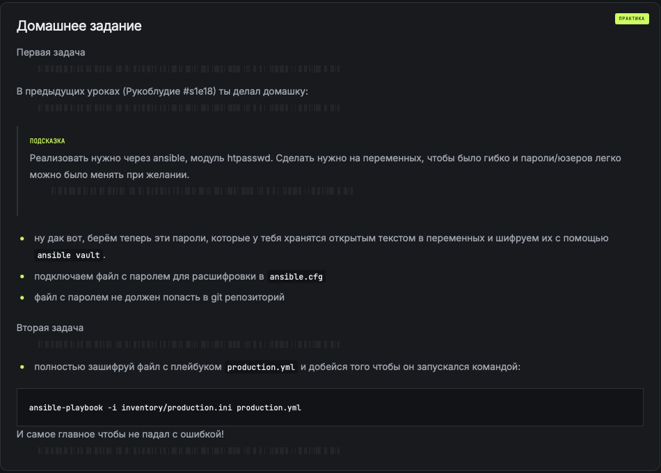
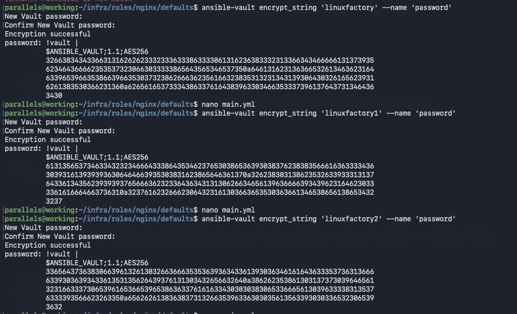

## Домашнее задание

### Первая задача

Первый прагон без файла в ansible.cfg и --ask-vault-pass (для проверки)
Второй прагон уже с добавлением параметра в в ansible.cfg

### Вторая задача

Зашифровал и запустил:

