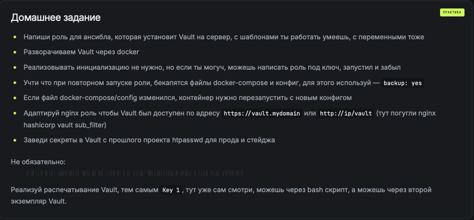
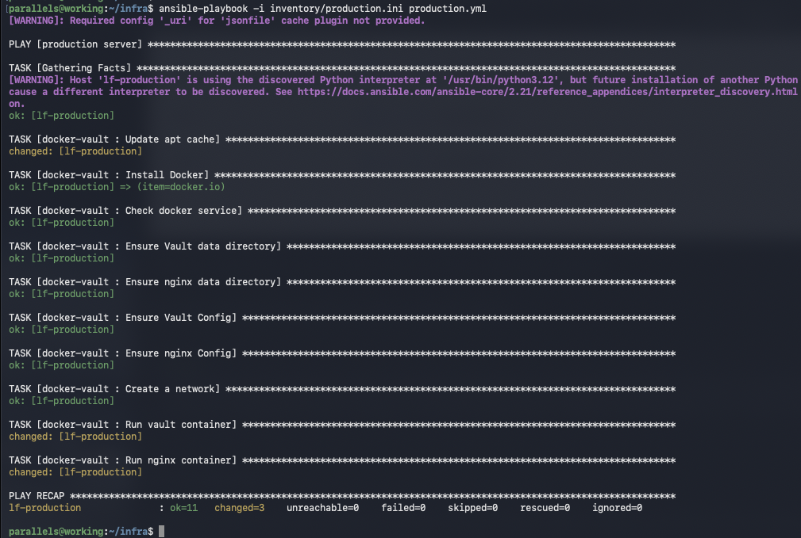
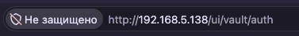
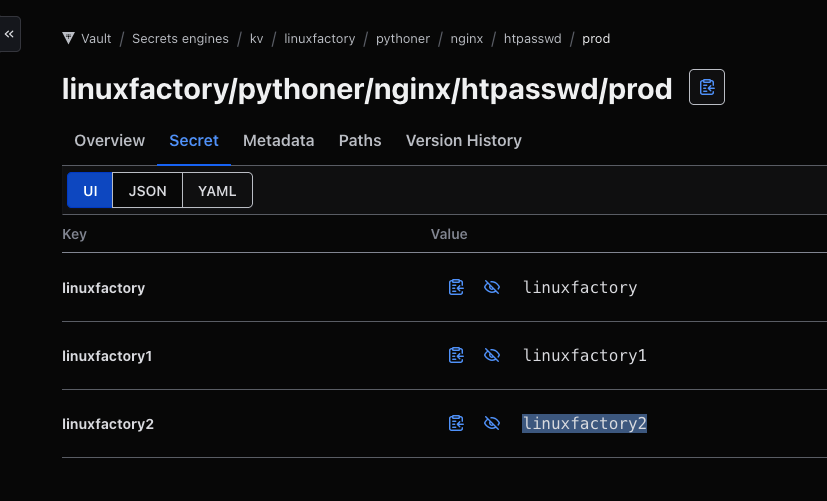
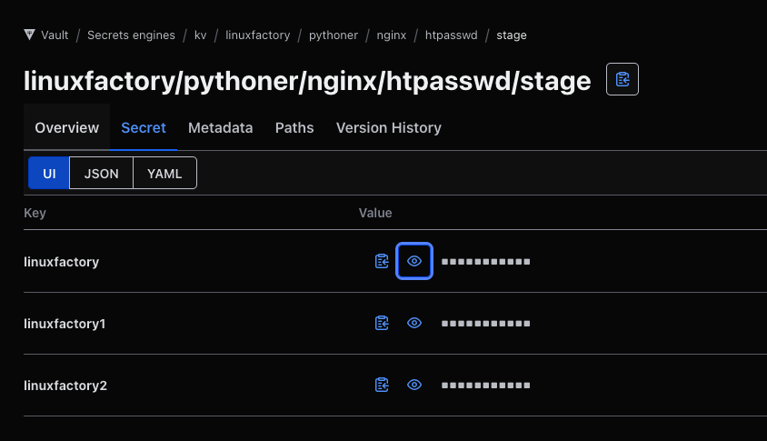

## Домашнее задание




 Вот тут моя роль: https://gitlab.com/avo1yanskiy/ansible-roles/-/tree/master/docker-vault?ref_type=heads
 


```
server {
    listen 80;
    server_name localhost;

    # Перенаправляем корень на /vault/ для удобства (опционально)
    location = / {
        return 301 /vault/;
    }

    location /vault/ {
        # Отрезаем /vault/ и отправляем в корень Vault
        rewrite ^/vault(/.*)$ $1 break;

        # ВАЖНО: используем имя контейнера vault, а не localhost
        proxy_pass http://vault:8200/;

        proxy_set_header Host $host;
        proxy_set_header X-Real-IP $remote_addr;
        proxy_set_header X-Forwarded-For $proxy_add_x_forwarded_for;
        proxy_set_header X-Forwarded-Proto $scheme;
    }

    # Проксируем пути UI и API напрямую (Vault будет их запрашивать)
    location /ui/ {
        proxy_pass http://vault:8200/ui/;
        proxy_set_header Host $host;
        proxy_set_header X-Real-IP $remote_addr;
        proxy_set_header X-Forwarded-For $proxy_add_x_forwarded_for;
        proxy_set_header X-Forwarded-Proto $scheme;
    }

    location /v1/ {
        proxy_pass http://vault:8200/v1/;
        proxy_set_header Host $host;
        proxy_set_header X-Real-IP $remote_addr;
        proxy_set_header X-Forwarded-For $proxy_add_x_forwarded_for;
        proxy_set_header X-Forwarded-Proto $scheme;
    }
}
```


Заведи секреты в Vault с прошлого проекта htpasswd для прода и стейджа:



