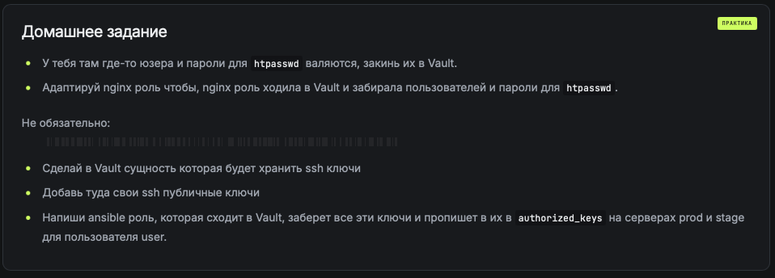

## Домашнее задание



 тут роль: https://gitlab.com/avo1yanskiy/ansible-roles/-/blob/master/nginx/tasks/main.yml?ref_type=heads

 Катал только на stage, у меня на prod висит контейнер с вольтом.

 И да я не делал "no_log: true" в таске "- name: get keys from vault" чтобы посмотреть что он выдаст


```
docker exec -it vault sh
export VAULT_TOKEN="hvs.shkR91b"
```

```
vault policy write my-policy -<<EOF
path "kv/data/linuxfactory/*" {
  capabilities = ["read", "list"]
}
EOF
```

```
vault token create -policy=my-policy -period=24h
```

```
curl --header "X-Vault-Token: hvs.токен" \
  --request GET \
  http://IP:8200/v1/kv/data/linuxfactory/pythoner/nginx/htpasswd/prod
```
