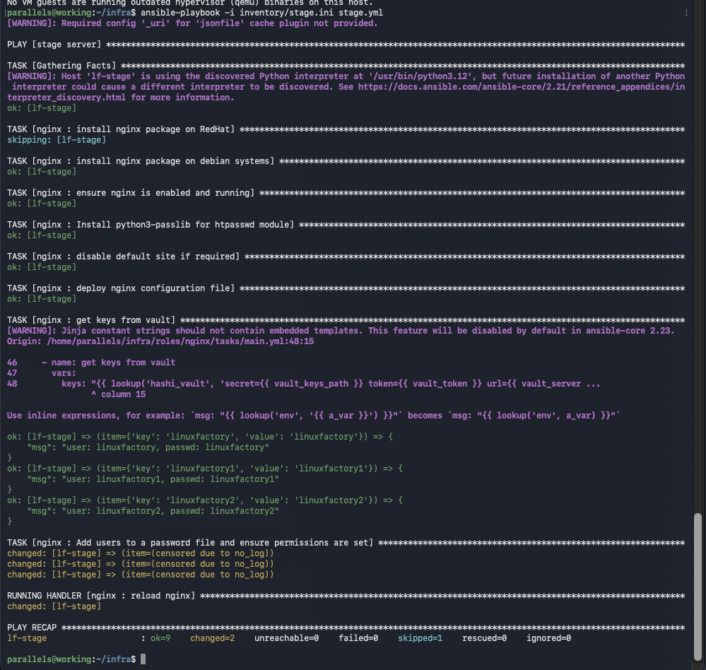

## Домашнее задание

 тут роль: https://gitlab.com/avo1yanskiy/ansible-roles/-/blob/master/nginx/tasks/main.yml?ref_type=heads

 Катал только на stage, у меня на prod висит контейнер с вольтом.

 И да я не делал "no_log: true" в таске "- name: get keys from vault" чтобы посмотреть что он выдаст

