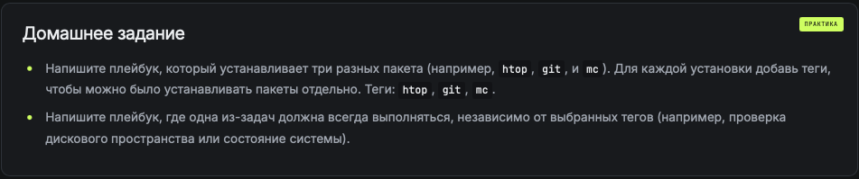
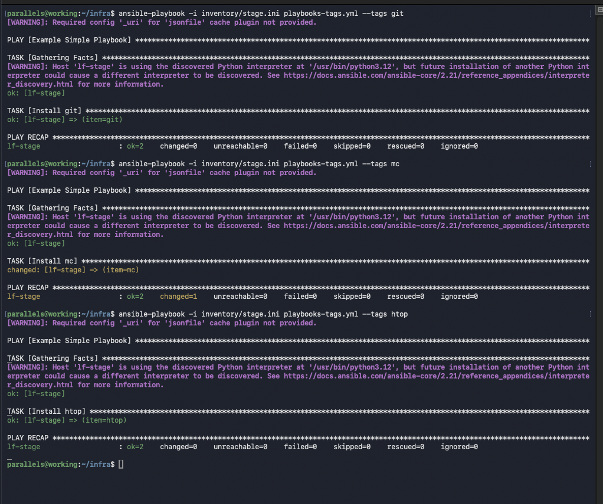

## Домашнее задание



## Первое задание:

https://gitlab.com/avo1yanskiy/infra/-/blob/main/playbooks-tags.yml?ref_type=heads

```yaml
---
- name: Example Simple Playbook
  hosts: stage
  become: yes
  tasks:
    - name: Update apt cache
      ansible.builtin.apt:
        update_cache: yes

    - name: Install htop
      ansible.builtin.apt:
        name: "{{ item }}"
        state: present
      loop:
        - htop
      tags: htop

    - name: Install git
      ansible.builtin.apt:
        name: "{{ item }}"
        state: present
      loop:
        - git
      tags: git

    - name: Install mc
      ansible.builtin.apt:
        name: "{{ item }}"
        state: present
      loop:
        - mc
      tags: mc
```



## Второе задание:

https://gitlab.com/avo1yanskiy/ansible-roles/-/blob/master/runners/tasks/main.yml?ref_type=heads

Для второго задания вот роль которая я использую для раскатки новых раннеров использовал уже пару раз для создания новых раннеров для заданий:
