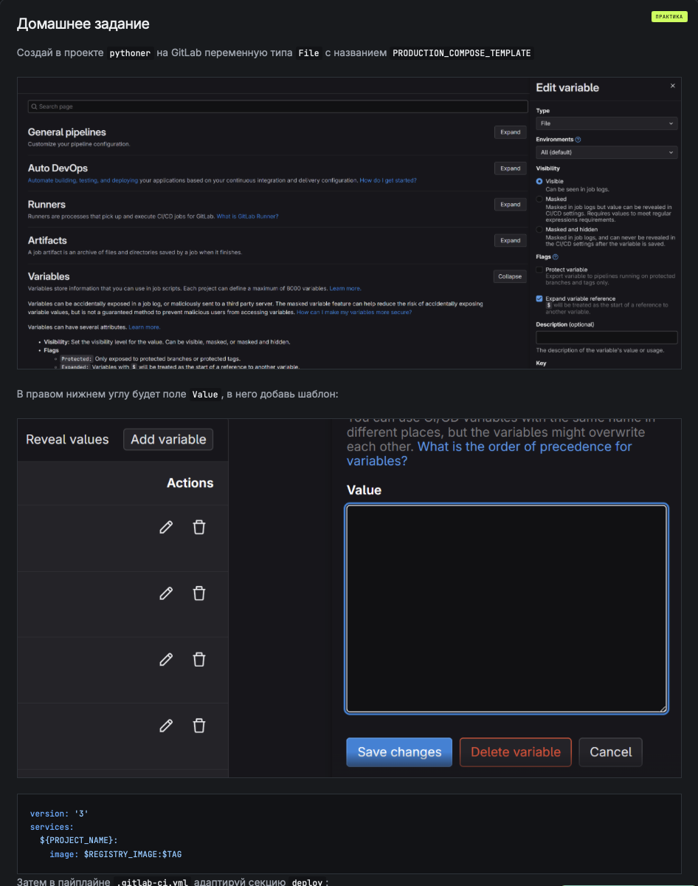
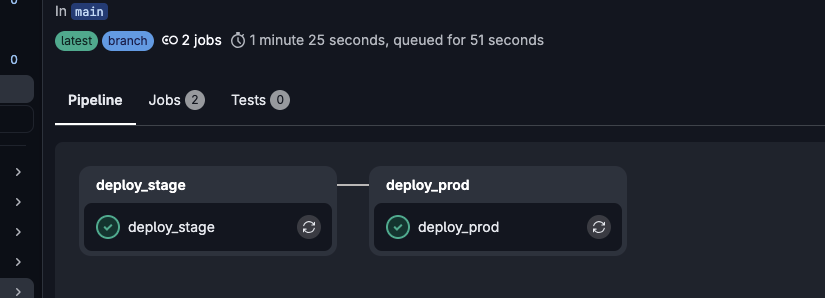
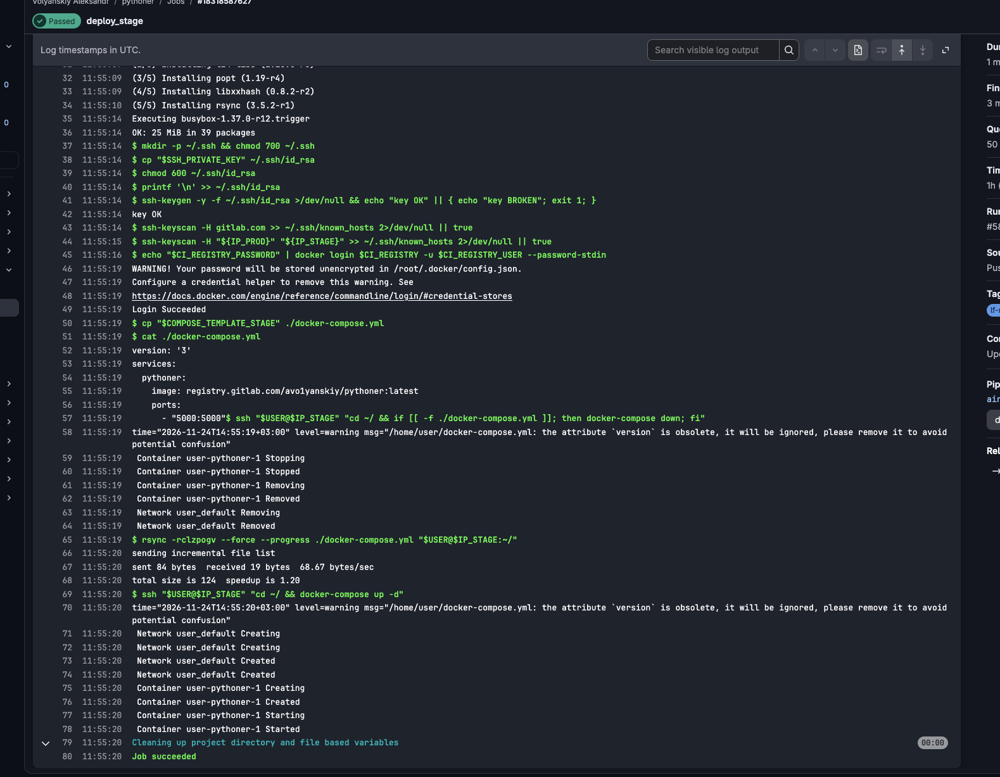
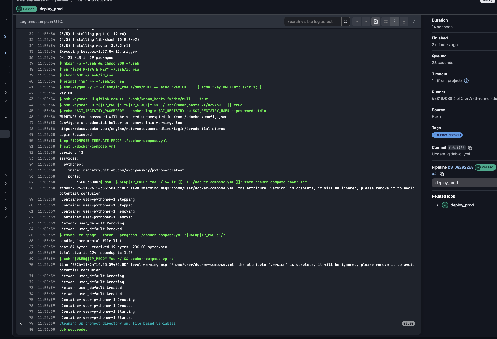
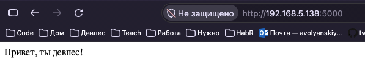
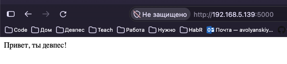

## Домашнее задание














```yaml
stages:
  # - build
  - deploy_stage
  - deploy_prod

variables:
  PROJECT_NAME: "pythoner"
  REGISTRY_IMAGE: "registry.gitlab.com/avo1yanskiy/pythoner:latest"
  TAG: "$CI_COMMIT_SHORT_SHA"
  COMPOSE_TEMPLATE_PROD: "$PRODUCTION_COMPOSE_TEMPLATE"
  COMPOSE_TEMPLATE_STAGE: "$STAGE_COMPOSE_TEMPLATE"
  USER: "user"
  RUNNER_TAG_STAGE: lf-runner-docker
  RUNNER_TAG_PROD: lf-runner-docker1
  IP_STAGE: 192.168.5.139
  IP_PROD: 192.168.5.138
  PORT: 5000

deploy_stage:
  stage: deploy_stage
  tags:
  - $RUNNER_TAG_STAGE

  before_script:
    - apk add --no-cache rsync openssh-client
    - mkdir -p ~/.ssh && chmod 700 ~/.ssh
    - cp "$SSH_PRIVATE_KEY" ~/.ssh/id_rsa
    - chmod 600 ~/.ssh/id_rsa
    - printf '\n' >> ~/.ssh/id_rsa
    - ssh-keygen -y -f ~/.ssh/id_rsa >/dev/null && echo "key OK" || { echo "key BROKEN"; exit 1; }
    - ssh-keyscan -H gitlab.com >> ~/.ssh/known_hosts 2>/dev/null || true
    - ssh-keyscan -H "${IP_PROD}" "${IP_STAGE}" >> ~/.ssh/known_hosts 2>/dev/null || true
  script:
    - echo "$CI_REGISTRY_PASSWORD" | docker login $CI_REGISTRY -u $CI_REGISTRY_USER --password-stdin
    - cp "$COMPOSE_TEMPLATE_STAGE" ./docker-compose.yml
    - cat ./docker-compose.yml
    - ssh "$USER@$IP_STAGE" "cd ~/ && if [[ -f ./docker-compose.yml ]]; then docker-compose down; fi"
    - rsync -rclzpogv --force --progress ./docker-compose.yml "$USER@$IP_STAGE:~/"
    - ssh "$USER@$IP_STAGE" "cd ~/ && docker-compose up -d"

deploy_prod:
  stage: deploy_prod
  tags:
  - $RUNNER_TAG_PROD

  before_script:
    - apk add --no-cache rsync openssh-client
    - mkdir -p ~/.ssh && chmod 700 ~/.ssh
    - cp "$SSH_PRIVATE_KEY" ~/.ssh/id_rsa
    - chmod 600 ~/.ssh/id_rsa
    - printf '\n' >> ~/.ssh/id_rsa
    - ssh-keygen -y -f ~/.ssh/id_rsa >/dev/null && echo "key OK" || { echo "key BROKEN"; exit 1; }
    - ssh-keyscan -H gitlab.com >> ~/.ssh/known_hosts 2>/dev/null || true
    - ssh-keyscan -H "${IP_PROD}" "${IP_STAGE}" >> ~/.ssh/known_hosts 2>/dev/null || true
  script:
    - echo "$CI_REGISTRY_PASSWORD" | docker login $CI_REGISTRY -u $CI_REGISTRY_USER --password-stdin
    - cp "$COMPOSE_TEMPLATE_PROD" ./docker-compose.yml
    - cat ./docker-compose.yml
    - ssh "$USER@$IP_PROD" "cd ~/ && if [[ -f ./docker-compose.yml ]]; then docker-compose down; fi"
    - rsync -rclzpogv --force --progress ./docker-compose.yml "$USER@$IP_PROD:~/"
    - ssh "$USER@$IP_PROD" "cd ~/ && docker-compose up -d"
```
