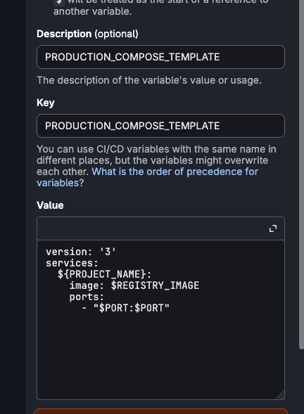
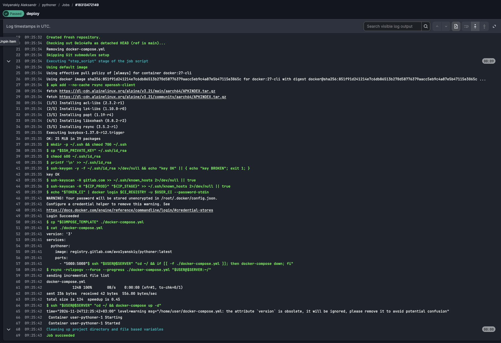
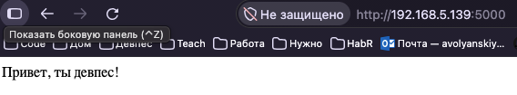

## Домашнее задание









Вот мой CI 

добавил порты , ИП на сервера, ключи для установки и авторизацию для скачивания $REGISTRY_IMAGE, а еще накинул установку rsync
```
stages:
  # - build
  - deploy

variables:
  PROJECT_NAME: "pythoner"
  REGISTRY_IMAGE: "registry.gitlab.com/avo1yanskiy/pythoner:latest"
  TAG: "$CI_COMMIT_SHORT_SHA"
  COMPOSE_TEMPLATE: "$PRODUCTION_COMPOSE_TEMPLATE"
  USER: "user"
  SERVER: "192.168.5.139"
  RUNNER_TAG: lf-runner-docker
  IP_STAGE: 192.168.5.139
  IP_PROD: 192.168.5.138
  PORT: 5000

deploy:
  stage: deploy
  tags:
  - $RUNNER_TAG

  before_script:
    - apk add --no-cache rsync openssh-client
    - mkdir -p ~/.ssh && chmod 700 ~/.ssh
    - cp "$SSH_PRIVATE_KEY" ~/.ssh/id_rsa
    - chmod 600 ~/.ssh/id_rsa
    - printf '\n' >> ~/.ssh/id_rsa
    - ssh-keygen -y -f ~/.ssh/id_rsa >/dev/null && echo "key OK" || { echo "key BROKEN"; exit 1; }
    - ssh-keyscan -H gitlab.com >> ~/.ssh/known_hosts 2>/dev/null || true
    - ssh-keyscan -H "${IP_PROD}" "${IP_STAGE}" >> ~/.ssh/known_hosts 2>/dev/null || true
  script:
    - echo "$TOKEN_CI" | docker login $CI_REGISTRY -u $USER_CI --password-stdin
    - cp "$COMPOSE_TEMPLATE" ./docker-compose.yml
    - cat ./docker-compose.yml
    - ssh "$USER@$SERVER" "cd ~/ && if [[ -f ./docker-compose.yml ]]; then docker-compose down; fi"
    - rsync -rclzpogv --force --progress ./docker-compose.yml "$USER@$SERVER:~/"
    - ssh "$USER@$SERVER" "cd ~/ && docker-compose up -d"
```
